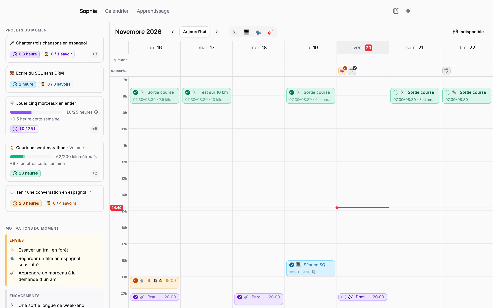
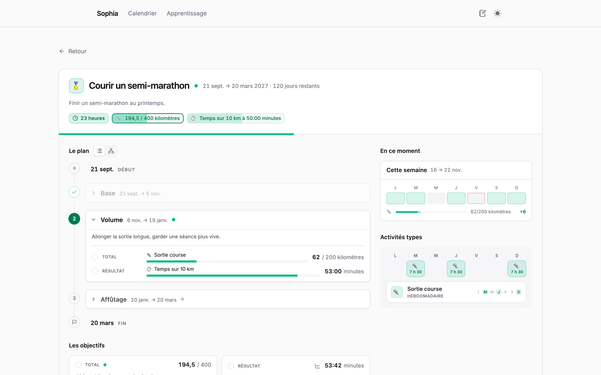
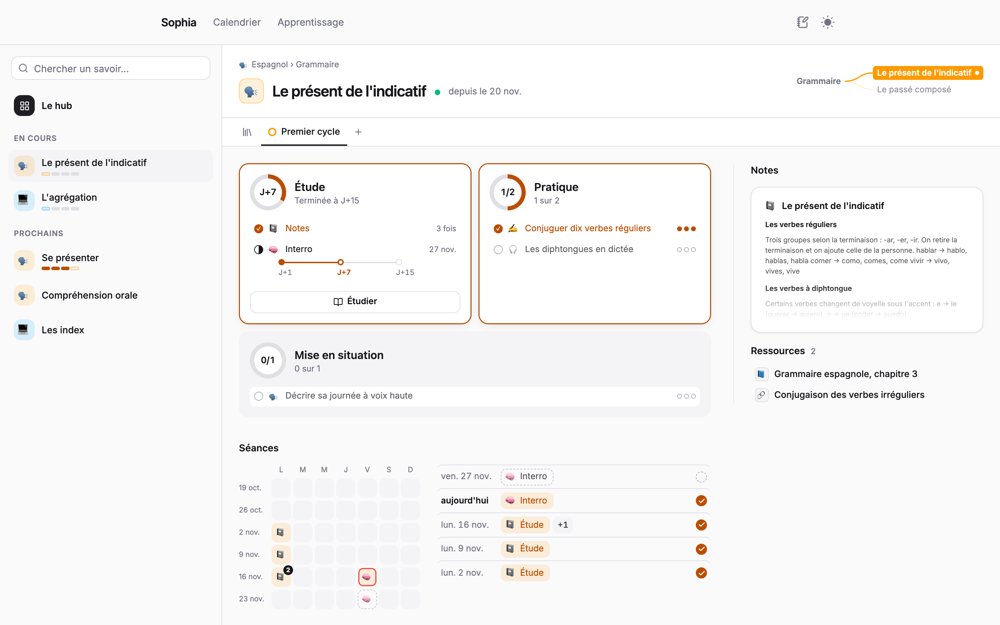
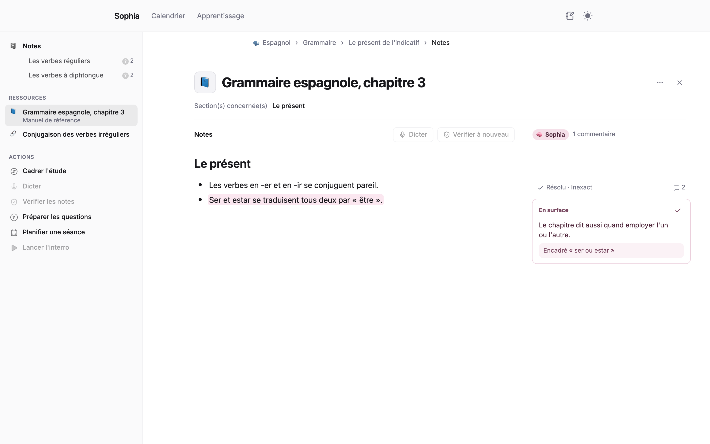

# Sophia (demo)

[](https://github.com/gaspardhurez/sophia-demo/actions/workflows/ci.yml)

Sophia is a personal skill-building app: it turns things you want to learn or achieve into projects, plans them on a calendar, and follows how each skill is actually acquired, from first study to long-term retention.

This repository is a **public snapshot** of a project I develop privately. The private repository holds my own data and working notes, so this version comes without its history and internal documentation, and ships with a fictional demo dataset instead.

## What it does

- **Domains and projects**: each domain (running, a language, an instrument…) holds projects with a start and an end, and up to four kinds of objectives: a *total* to reach (kilometres, hours, sessions), a *result* to measure (a time on 10 km), *achievements* to tick off, and *skills* to learn.
- **A calendar of activities**: recurring activity types are planned on chosen weekdays and slots; each activity can log values, count towards several projects, and record what was studied or practised.
- **A skill tree**: skills are organised per domain, each with a status.
- **Acquisition cycles**: for a skill, a plan chains study (resources, rich-text notes with examples and annotations), recall sessions on spaced intervals, practice items and retention.
- **An optional AI companion** for study sessions: dictation, note review, central-idea extraction, replies in comment threads, and *Cadrer l'étude* (framing a study cycle: intention, scope, web search for resources). It sits behind ports, so the app works without it.

## Screenshots

The demo dataset, in the app.

**Calendar**: the week, the projects of the moment, wishes and commitments.



**A project**: its plan in steps, each with a share of the total and a target on the 10 km time.



**A skill**: its acquisition cycle (study and recall curve, practice, real-life use) and its sessions.



**Notes on a resource**, with the AI companion's review comments (written by the demo seed, not by a live model): one open, one resolved after a reply.



## Architecture

**Backend**: Python, FastAPI, SQLAlchemy 2.0 (sync), Alembic, Pydantic v2, SQLite.

- Clean architecture applied pragmatically: `api` → `application` (use cases) → `domain` (pure business rules, no framework dependency), with `infrastructure` (ORM models, config, LLM and transcription adapters) serving the application layer.
- The LLM sits behind `Companion` and `Transcriber` ports; tests never call it.
- Migrations are guarded: every `alembic upgrade` / `downgrade` backs up the database first, and migrations run with foreign keys disabled so SQLite table rebuilds cannot cascade-delete child rows.
- 900+ tests (pytest), each on a fresh in-memory database.

**Frontend**: React, TypeScript, Vite, Tailwind, shadcn/ui, TanStack Query, React Router, React Hook Form + Zod, TipTap for the notes editor.

- Organised with **Feature-Sliced Design** (`app → pages → widgets → features → entities → shared`), with one-way dependencies and a public API per slice, enforced by a linter (steiger).

**The contract**: the backend's OpenAPI schema is the single source of truth. The frontend's types and API client are generated from it (openapi-typescript, openapi-fetch), so no type is duplicated by hand between back and front.

## How this project is built

Sophia is developed with an AI coding agent (Claude Code), and I treat that as an engineering method rather than a shortcut. I own the architecture, the conventions and the product decisions; the agent implements within a written framework, starting with the instructions file it reads before any change: [`CLAUDE.md`](CLAUDE.md) (in French, like the rest of the project). In the private repository, it also works from a product documentation kept up to date in the same commit as the code, and a decision log recording what each choice replaced and why.

I review the changes and keep the architecture rules enforced by tooling: 900+ backend tests, Ruff, oxlint, Feature-Sliced Design rules checked by steiger, and an OpenAPI contract from which the frontend types are generated.

## Run it locally

Requirements: [uv](https://docs.astral.sh/uv/), [Node.js](https://nodejs.org/) and [pnpm](https://pnpm.io/).

```bash
make install     # backend (uv) and frontend (pnpm) dependencies
make demo        # create the database and load the demo dataset
make gen-client  # generate the typed API client from the OpenAPI schema
make dev         # API on http://localhost:8000, app on http://localhost:5173
```

The AI companion is optional:

- `ANTHROPIC_API_KEY` in `backend/.env` enables the LLM features (note review, central ideas, thread replies, *Cadrer l'étude*, and the clean-up step of dictation).
- `SOPHIA_LLM_BACKEND=subscription` routes those calls through a local Claude Code CLI (`claude`) instead, with the API key as a fallback if set.
- Dictation also needs local transcription (mlx-whisper, Apple Silicon only): `cd backend && uv sync --extra transcription`.

```bash
cd backend && uv run pytest -q   # tests
make lint                        # ruff, oxlint and FSD rules (checks only)
make format                      # rewrites files: ruff format and prettier
```

The interface and the demo data are in French, the language the app was built in.
